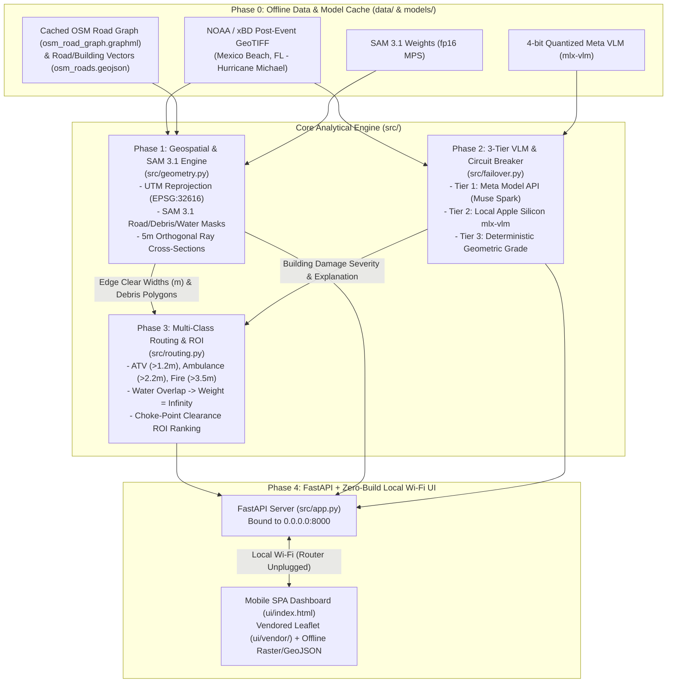

# FirstLight — Comprehensive 5-Phase Implementation Blueprint (`PLAN.md`)

**Hardware Profile:** Apple Silicon MacBook Pro M1 Max (64 GB Unified Memory)  
**Precision & Compute Policy:** Strictly `float16` (`fp16`) on PyTorch `mps` and 4-bit quantized models on `mlx-vlm` (never `bfloat16`).  
**Core Invariant:** SAM 3.1 operates as a *geometric measurement instrument* (computing clear road spans in meters via orthogonal cross-sectional ray casting), and all routing weights, Choke-Point Clearance ROI scores, and UI reason strings are mathematically derived with 100% offline resilience.

---

## System Architecture

---

## Phase 0: Environment Setup, Dependencies & Hurricane Michael Data Staging

### Objectives
1. Establish a reproducible Python 3.11+ environment tailored for Apple Silicon (`PyTorch MPS` + `mlx-vlm` + `Rasterio` + `GeoPandas` + `OSMnx` + `NetworkX` + `Shapely`).
2. Cache the OpenStreetMap road network and building footprints for **Mexico Beach, FL (Highway 98 Corridor — Hurricane Michael AOI)**:
   - `data/osm_road_graph.graphml` (OSMnx topological road graph)
   - `data/osm_roads.geojson` & `data/osm_buildings.geojson` (Vector GeoJSON overlays)
3. Stage high-resolution post-Hurricane Michael aerial GeoTIFF imagery (`data/noaa_michael_mexico_beach.tif`) covering the Highway 98 corridor in Mexico Beach, FL, with verified Coordinate Reference System (CRS) and metric Ground Sample Distance (GSD in meters/pixel).
4. Vendor offline Leaflet assets (`ui/vendor/leaflet.js`, `ui/vendor/leaflet.css`, and marker assets) so the mobile frontend requires zero external CDN requests when the internet router is unplugged.

---

## Phase 1: Geospatial Alignment & SAM 3.1 Cross-Sectional Width Engine (`src/geometry.py`)

### Objectives
Use SAM 3.1 as a geometric measurement instrument to compute exact road clearance widths in meters along every OSM road edge.

### Technical Specifications
1. **Coordinate Reference System (CRS) Alignment (`align_graph_to_raster`):**
   - Inspects the input GeoTIFF (`rasterio.open`).
   - Reprojects the OSM road graph (`EPSG:4326`) and raster bounds into the native metric CRS or local UTM zone (`EPSG:32616` — WGS 84 / UTM Zone 16N for Mexico Beach, FL, where 1 unit = $1.0\text{ meter}$).
   - Computes exact horizontal/vertical pixel-to-meter Ground Sample Distance ($\text{GSD} = \sqrt{|\Delta x \cdot \Delta y|}$ in meters/pixel).
2. **SAM 3.1 Mask Generation (`segment_disaster_scene`):**
   - Executes SAM 3.1 on `torch.device("mps")` in `torch.float16` over tiled GeoTIFF windows.
   - Vectorizes binary masks via `rasterio.features.shapes` into metric `shapely.geometry.MultiPolygon` layers:
     - `road_surface_poly`: Passable road surface
     - `debris_poly`: Rubble, structural collapse, downed trees
     - `water_poly`: Floodwater / coastal surge washouts
3. **Orthogonal Cross-Sectional Ray Casting (`measure_edge_clearance`):**
   - Walks each UTM road centerline `LineString` at regular intervals of $\Delta s = 5.0\text{ meters}$.
   - Computes unit tangent vector $\vec{t} = (dx, dy)$ via finite difference and orthogonal normal vector $\vec{n} = (-dy, dx)$.
   - Casts a cross-sectional ray segment $S_i = [P_i - R_{\max}\vec{n},\; P_i + R_{\max}\vec{n}]$ (with $R_{\max} = 10.0\text{ m}$).
   - **Water Rule Check:** If the road segment or cross-section intersects `water_poly`, marks `has_water_obstruction = True` and `min_clear_width_m = 0.0`.
   - **Clear Span Calculation:** Computes $C_i = S_i \cap (\text{road\_surface\_poly} \setminus \text{debris\_poly})$. If $C_i$ is a `MultiLineString` (split by debris), takes the maximum contiguous `LineString` length in meters.
   - Records `min_clear_width_m`, `bottleneck_coords_lonlat`, `debris_area_m2`, and all cross-section geometries for UI inspection.

---

## Phase 2: 3-Tier VLM Damage Grading & Connectivity Router (`src/failover.py`)

### Objectives
Provide seamless, fault-tolerant vision-language damage grading (xBD 0–3 scale) and tactical situation summaries across cloud, edge Apple Silicon, and deterministic offline modes.

### Technical Specifications
1. **Tier 1 — Cloud Primary (`CLOUD_MUSE_SPARK`):**
   - Queries Meta Model API (`https://api.meta.ai/v1/chat/completions`) via `httpx.AsyncClient(timeout=2.5)`.
   - Passes cropped RGB imagery of the bottleneck/structure alongside exact geometric telemetry (`min_clear_width_m`, `debris_area_m2`, `gsd_m_per_px`).
2. **Tier 2 — Edge Apple Silicon Fallback (`LOCAL_MLX_VLM`):**
   - Automatically engages on network timeout, connection error, or air-gapped operation.
   - Runs a 4-bit quantized local Meta Vision model via `mlx-vlm` (`mlx_vlm.load` / `mlx_vlm.generate`).
   - **Memory Safety:** Implements an explicit unified memory context manager (`gc.collect()`, `mx.metal.clear_cache()`) when loading/unloading weights so 64 GB unified memory never swaps during concurrent SAM 3.1 + VLM workloads.
3. **Tier 3 — Deterministic Geometric Fallback (`DETERMINISTIC_GEOMETRY`):**
   - Computes damage severity and passability explanations strictly from SAM 3.1 polygon intersection ratios (`debris_overlap_ratio`, `water_overlap`) and metric widths.
4. **Zero-Hallucination Guarantee:**
   - All tiers inject verified mathematical values directly into the structured output; no unverified counts or widths are ever emitted.

---

## Phase 3: Multi-Class NetworkX Vehicle Routing & Choke-Point Clearance ROI (`src/routing.py`)

### Objectives
Route emergency vehicles according to physical width and water constraints, and rank debris bottlenecks by **Clearance ROI**.

### Technical Specifications
1. **Vehicle Clearance Thresholds:**
   - **ATV / On Foot (`ATV_FOOT`):** `min_clear_width_m > 1.2m`
   - **Ambulance / Pickup (`AMBULANCE_PICKUP`):** `min_clear_width_m > 2.2m`
   - **Fire Engine (`FIRE_ENGINE`):** `min_clear_width_m > 3.5m`
2. **Graph Edge Weighting:**
   - Any edge with `has_water_obstruction == True` has weight $w = \infty$ across all vehicle classes, regardless of width.
   - Any edge with `min_clear_width_m <= threshold[vehicle_class]` has weight $w = \infty$ for that vehicle class.
   - Passable edges receive weight $w = \text{length\_m} / \text{effective\_speed\_mps}$.
3. **Choke-Point Clearance ROI Ranking (`rank_choke_points_roi`):**
   - Evaluates each debris-blocked edge $e_k$ (where `has_water_obstruction == False` and `debris_area_m2 > 0`).
   - Simulates clearing $e_k$ and computes $\Delta R(e_k, c)$: the set of high-severity building structures (damage grade $\ge 2$) newly reachable from the command post for vehicle class $c$.
   - Computes:
     $$\text{Clearance ROI}(e_k, c) = \frac{\text{High-Severity Structures Unlocked}(e_k, c)}{\text{Debris Area Cleared in m}^2(e_k)}$$
   - Emits a deterministic mathematical justification string for every ranked bottleneck.

---

## Phase 4: FastAPI Backend (`src/app.py`) & Mobile Dashboard (`ui/index.html`)

### Objectives
Deliver a zero-build, instant-loading mobile tactical dashboard served over local Wi-Fi (`0.0.0.0:8000`) when the internet router is unplugged.

### Technical Specifications
1. **FastAPI Application (`src/app.py`):**
   - Serves `ui/index.html` and static `/vendor/*` assets locally.
   - Endpoints:
     - `GET /api/status`: Connectivity tier status, MPS/MLX unified memory metrics, raster CRS & GSD.
     - `GET /api/map-layers`: Cached GeoJSON for OSM road edges, cross-section rays, debris/water masks, and building footprints.
     - `GET /api/raster-overlay`: Local PNG rendering & WGS84 bounds of the Mexico Beach GeoTIFF.
     - `POST /api/route`: Multi-class routing (`ATV_FOOT`, `AMBULANCE_PICKUP`, `FIRE_ENGINE`) with detour diagnostics.
     - `GET /api/choke-points`: Ranked Choke-Point Clearance ROI list with mathematical explanations.
     - `POST /api/simulate-clear`: Interactive simulation of debris clearance at selected bottleneck edges.
     - `POST /api/failover-mode`: Live circuit-breaker mode selector (`AUTO`, `CLOUD`, `MLX`, `DETERMINISTIC`).
2. **Zero-Build Mobile Frontend (`ui/index.html`):**
   - Built with vanilla HTML5/CSS/JS and locally vendored Leaflet (`ui/vendor/leaflet.js`, `ui/vendor/leaflet.css`).
   - Features vehicle class switcher tabs, live connectivity tier badge, interactive 5m cross-section ray inspector, and a swipeable Choke-Point Clearance ROI drawer.
