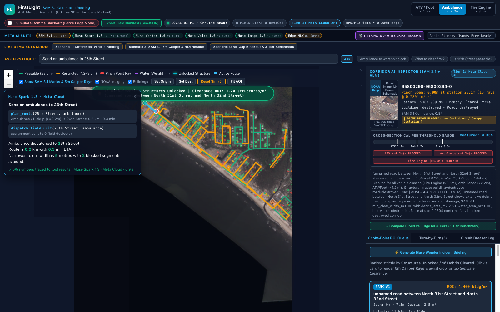
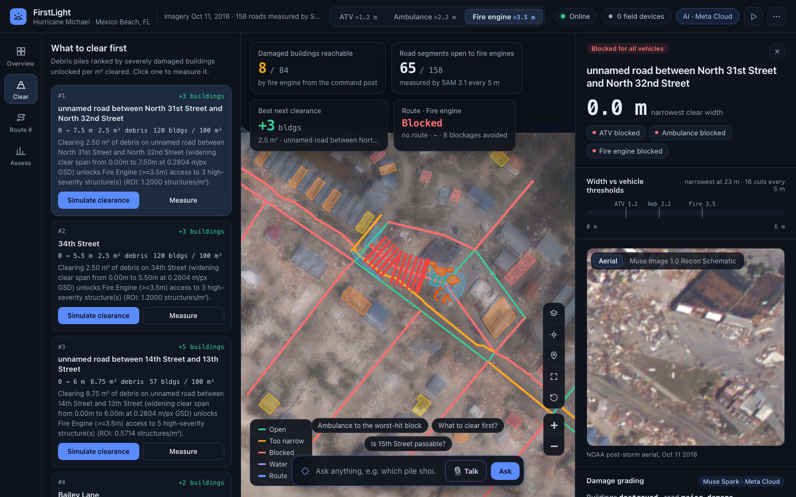
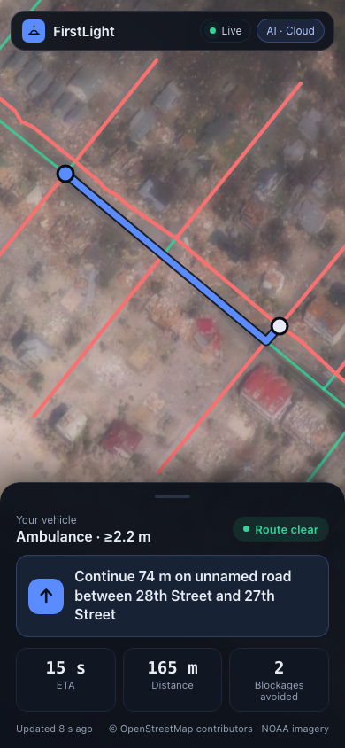
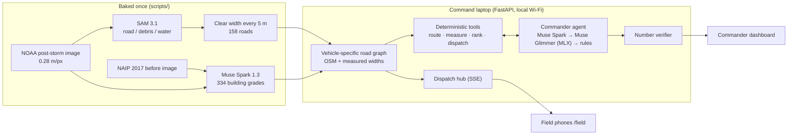

# FirstLight

**Offline-first disaster access mapping.** FirstLight tells emergency responders not just which buildings are damaged, but which vehicle (fire engine, ambulance or ATV) can physically reach them, and it keeps working when the internet goes down.

Built for the **Meta Global AI Developer Hackathon** (Track A, *Build for Your World*) on a real event: **Hurricane Michael at Mexico Beach, Florida** (landfall Oct 10, 2018).



---

## Why

Damage maps (xView2, Microsoft and others) show *what* is destroyed. After a hurricane, responders also need to know *what they can reach*: a street with 2.8 m of clear pavement lets an ambulance through but stops a fire engine. They need that answer when cell towers and backhaul are down.

## What it does

| | |
| :--- | :--- |
| **SAM 3.1 as a measuring instrument** | Segments visible pavement, debris and standing water on the post-storm aerial image, then measures the **clear road width in metres every 5 m** along all 158 roads. |
| **Vehicle-specific routing** | ATV needs > 1.2 m, ambulance > 2.2 m, fire engine > 3.5 m; standing water closes a road for everyone; ambulances and fire engines stay off footways. |
| **Building damage from before/after imagery** | Muse Spark grades all 334 buildings from a 2017 (before) / 2018 (after) image pair. |
| **What to clear first** | Ranks debris piles by severely damaged buildings unlocked per m² cleared. |
| **Commander agent with verified answers** | Ask in plain language. Muse Spark calls deterministic tools, and **every number in its answer is checked against the tool results**. |
| **Three-tier failover** | Meta Cloud (Muse Spark) → Muse Glimmer 30B on the laptop (MLX, 4-bit) → no-model geometry and routing. The map never goes dark. |
| **Live field phones over local Wi-Fi** | Phones follow the commander's dispatch in real time and detect internet loss within about 5 s. |
| **Honest, held-out benchmark** | Model outputs are scored against blind hand labels; tuning and test sets are separate. |

<p align="center">
  
  
</p>

---

## Meta models and how they are used

| Model | Where it runs | Job in FirstLight |
| :--- | :--- | :--- |
| **SAM 3.1** (`Sam3Model`, fp16) | Locally on Apple Silicon (PyTorch MPS) | Text-prompted segmentation (`road`, `debris`, `standing water`) on 89 road tiles; the probability maps drive the 5 m width measurements. Baked once (~5 min on an M1 Max), so the field laptop needs no GPU work at demo time. |
| **Muse Spark 1.3** (`muse-spark-1.3`) | Meta Model API | (1) Grades each building from a before/after image pair (xBD scale). (2) Plans the commander agent's tool calls with native function calling and writes the answer. (3) Grades a selected road corridor from its aerial crop. |
| **Muse Glimmer 30B, 4-bit** (open weights) | Locally on Apple Silicon (MLX) | Offline fallback for grading and for the agent (same tools via a JSON action protocol). Kept resident in memory. Grades with low reasoning; agent steps skip reasoning, since every number is verified against tool output anyway. Chosen over Llama 3.2 11B Vision on the held-out test set ([comparison](#offline-model-choice)). |

Experimental integrations (in the UI, not part of the core demo): **Muse Wonder 1.0** incident briefing, **Muse Image 1.0** recon schematic, and a voice-dispatch button that currently parses a preset command (no microphone capture yet). Each labels its output with the model or fallback that produced it.

---

## How it works



**Road width measurement** ([`src/sam_measure.py`](src/sam_measure.py)). At every 5 m along each OSM centerline, a 30 m cross-section is sampled every 0.25 m from SAM's probability maps:
- Pavement is detected at p ≥ 0.5, and its width is measured over the confident core (p ≥ 0.7). This trims the blur that comes from upsampling SAM's 288-cell maps.
- The run of pavement **nearest the OSM line** is used, which absorbs the few-metre misalignment between OSM and the imagery.
- Widths are capped by OSM road type, so parking lots and intersections can't inflate a street.
- An obstruction must persist over two consecutive cross-sections before it closes a road.
- Gaps are attributed to **debris** (clearable), **standing water** (impassable), or **not visible**. Not-visible gaps are treated as impassable and flagged for drone reconnaissance.

**Routing and clearance** ([`src/routing.py`](src/routing.py)). Edge weights are length / speed (ATV 8.0, ambulance 13.5, fire engine 11.2 m/s) on passable edges and ∞ otherwise. The clearance queue simulates removing each debris pile and counts the severely damaged buildings that become reachable from the command post at US‑98 & 28th Street.

**Commander agent** ([`src/agent.py`](src/agent.py), [`src/agent_tools.py`](src/agent_tools.py)). Six tools: `measure_road`, `damage_hotspots`, `plan_route`, `rank_clearance`, `reachability_summary`, `dispatch_field_unit`. They only read the measured graph and the graded buildings. After the model answers:
- every number in the answer is matched against the tool results;
- untraceable numbers get one rewrite, then are shown in red;
- dispatch refuses destinations with no passable route.

**Failover and field sync** ([`src/failover.py`](src/failover.py), [`src/dispatch.py`](src/dispatch.py)):
- A 5 s TCP probe detects internet loss, so Tier 1 is skipped immediately rather than timing out.
- Real Muse Spark answers are cached, and the top choke points are pre-warmed at startup.
- Phones receive route updates over Server-Sent Events.

---

## Results (held-out, labelled blind)

Labels were recorded in the built-in `/label` tool, which never shows model answers. Tuning used the **dev** set only. The **test** set was drawn afterwards with a different seed, disjoint from dev.

| Measure | Dev baseline | Dev after tuning | **Test (held-out)** |
| :--- | :---: | :---: | :---: |
| SAM 3.1 width, median absolute error | 1.94 m | 1.37 m | **0.39 m** |
| SAM 3.1 width, mean error / bias | 3.45 m / +2.22 m | 2.22 m / +0.53 m | **1.09 m / −0.04 m** |
| Passability agreement ATV / ambulance / fire engine | 78 / 83 / 80 % | 78 / 83 / 78 % | **97 / 94 / 97 %** |
| False-passable (dangerous) ATV / ambulance / fire | 5 / 3 / 5 | 5 / 3 / 5 | **0 / 0 / 0** |
| Muse Spark grade within one class | 88 % | 90 % | **89 %** |
| Muse Spark exact 4-class match | 58 % | 68 % | **47 %** |
| High-severity recall / precision | 1.00 / 0.38 | 1.00 / 0.56 | **0.40 / 0.22** |

- **Sample sizes:** roads, 40 dev and 35 test (5 marked "can't tell"); buildings, 40 dev and 38 test. Only 5 test buildings are major or destroyed, so the building scores carry wide uncertainty.
- **Confidence is calibrated:** on the test set, stations with SAM confidence ≥ 0.8 have a mean error of 0.35 m, versus 4.06 m at 0.6–0.8. That is why low-confidence stations are flagged for drone reconnaissance.
- **What was tuned on dev:**
  - the core-width rule and the road-type caps (the caps are typical US curb-to-curb widths, not fitted to the labels);
  - an xBD-strict grading prompt.
- **On today's data:** from the command post, an ambulance reaches 11 of the 84 buildings Muse Spark grades major or destroyed. The clearance queue shows which piles change that.

Reproduce: `./.venv/bin/python benchmarks/run_benchmarks.py` → [`benchmarks/benchmark_results.json`](benchmarks/benchmark_results.json).

### Offline model choice

Two open-weights models were scored on the same 38 held-out test buildings, using the same prompt and before/after images as Muse Spark, on the M1 Max:

| Model (MLX, 4-bit) | Exact | Within one class | High-severity recall / precision | Median s per building | Agent questions answered with a tool call |
| :--- | :---: | :---: | :---: | :---: | :---: |
| Llama 3.2 11B Vision | 5 % | 13 % | 1.00 / 0.13 | 14.8 | 1 / 3 |
| Muse Glimmer 30B, reasoning skipped | 18 % | 26 % | 1.00 / 0.15 | 15.7 | 3 / 3 |
| **Muse Glimmer 30B, low reasoning** | **53 %** | **76 %** | **1.00 / 0.28** | 38.8 | **3 / 3** |
| *Muse Spark 1.3 (cloud, for reference)* | *47 %* | *89 %* | *0.40 / 0.22* | — | — |

- **Llama calls almost everything severe.** It also answered "Is 15th Street passable?" without measuring the road.
- **Muse Glimmer at low reasoning grades.** It is now the offline tier.
- **Agent steps skip reasoning.** Tool choice is just as good without it, and every number in the answer is verified against tool output either way.

Reproduce: `./.venv/bin/python benchmarks/edge_model_comparison.py` → [`benchmarks/edge_model_comparison.json`](benchmarks/edge_model_comparison.json) (about 50 min).

## Limitations

- **Sand-covered pavement:** SAM can confidently read it as clear road (3 false-passables on dev).
- **SAM misses some faint roads:** these are treated as blocked and flagged for drone reconnaissance (the conservative choice).
- **Building grading is the weakest part:**
  - the 2017 NAIP "before" image is 1 m resolution, and OSM footprints can be offset by several metres;
  - tuning gains on dev did not carry over to test.

  Treat grades as triage hints.
- **Meta's content filter** occasionally rejects harmless questions. The agent says so and answers on the laptop instead.
- **Cloud agent answers take about 7–12 s;** the steps appear live while it works.
- **Offline is slower:**
  - each agent step takes about 20 s on the laptop, and a question takes 45–85 s;
  - an offline road grade takes about 85 s. Warm-up pre-grades the top five choke points on the laptop, so those open instantly.

---

## Quickstart

Apple Silicon Mac, Python 3.11+.

```bash
python3 -m venv .venv && ./.venv/bin/pip install -r requirements.txt
./.venv/bin/python scripts/setup_data_and_models.py --check      # or --download on a fresh clone
echo 'export MODEL_API_KEY=your_meta_model_api_key' > .env       # optional; without it FirstLight runs on-device
./.venv/bin/uvicorn src.app:app --host 0.0.0.0 --port 8000
```

| Page | URL |
| :--- | :--- |
| Commander dashboard | `http://localhost:8000/` |
| Field phone (same Wi-Fi) | `http://<laptop-ip>:8000/field` (hover the **FIELD LINK** pill for the address) |
| Blind labelling tool | `http://localhost:8000/label` |

Rebuild the derived data (all offline after the first download):

| Script | Produces |
| :--- | :--- |
| `scripts/fetch_pre_event_naip.py` | `data/naip_2017_mexico_beach.tif` (before image) |
| `scripts/bake_sam31_masks.py` | SAM 3.1 probabilities, masks and road measurements (`--remeasure` reuses the probabilities) |
| `scripts/grade_buildings_muse_spark.py` | Muse Spark building grades (cached and resumable; about $1 of API credit for all 334) |
| `scripts/build_map_tiles.py` | Full-resolution offline map tiles |
| `scripts/make_benchmark_samples.py` | Held-out label samples (`--set test` for the final set) |

Environment switches:

| Variable | Effect |
| :--- | :--- |
| `FIRSTLIGHT_WARMUP=0` | Skip the startup Muse Glimmer load and the Muse Spark / Muse Glimmer pre-grading of the top choke points. |
| `FIRSTLIGHT_SPARK_REASONING_EFFORT=` | Use Muse Spark's default reasoning effort (default here: `low`). |
| `FIRSTLIGHT_UPLINK_PROBE=0` | Disable internet-loss detection. |

Tests: `./.venv/bin/pytest`.

---

## Hackathon build log

The hackathon kicked off Oct 26, 2026 at 12:00 PM ET; the building period runs Oct 27 – Nov 4.

- **Before kickoff:** the project plan ([`PLAN.md`](PLAN.md)), agent rules ([`AGENTS.md`](AGENTS.md), `.agents/`), and downloads of public datasets and model weights (NOAA imagery, OpenStreetMap extracts, SAM 3.1 and Llama 3.2 weights).
- **Kickoff day (Oct 26):** scaffolding (`04542ed`, 12:01 PM). First code commit `b489ebe` at 12:15 PM. First versions of measurement, routing, failover, the API and the dashboard, then the field-phone sync, latency work and the measurement replay (`00cb66e` … `bc39159`).
- **Building period (Oct 27 onward):**
  - real SAM 3.1 measurements replacing rule-placed obstacle polygons (`6410e01`);
  - blind labelling and the held-out benchmark (`2e1b948`, `a6e53af`);
  - per-building Muse Spark grading from before/after imagery (`302c3f9`, `bdb80f6`);
  - the commander agent with verified answers (`c7402dc`);
  - offline full-resolution tiles (`e29bd14`), and fixes (see `git log`);
  - Muse Glimmer 30B replacing Llama 3.2 Vision as the offline tier after a held-out comparison (Oct 28).

---

## Repository layout

```text
src/
  app.py            FastAPI server: API, dashboards, labelling, tiles
  sam_measure.py    SAM 3.1 visible-pavement width measurement
  geometry.py       Reprojection, SAM 3.1 instrument wrapper, caliper GeoJSON
  routing.py        Vehicle-specific graph, routing, clearance ranking
  agent.py          Commander agent: tiers, tool loop, number verifier
  agent_tools.py    Deterministic tools the agent may call
  failover.py       3-tier grading (Muse Spark → MLX Muse Glimmer → geometry), resident MLX runtime
  mlx_patches.py    mlx-vlm cross-attention K/V memo (Llama 3.2 Vision, used in the model comparison)
  dispatch.py       Live dispatch hub (SSE) and internet-loss probe
  labeling.py       Blind labelling API
ui/                 Commander dashboard, field phone view, labelling page (Leaflet vendored)
scripts/            Data fetch, SAM bake, Muse Spark grading, tiles, benchmark samples
benchmarks/         run_benchmarks.py and results
data/               OSM extracts, SAM measurements, building grades, labels (rasters/tiles rebuilt by scripts)
tests/              pytest suite
docs/img/           Screenshots
```

---

## Licenses and attribution

- **Code:** MIT ([`LICENSE`](LICENSE)).
- **Muse Glimmer 30B:** the offline tier uses `mlx-community/Muse-Glimmer-30B-4bit` (Apache 2.0).
- **Built with Llama.** The offline-model comparison also runs `mlx-community/Llama-3.2-11B-Vision-Instruct-4bit`, licensed under the Llama 3.2 Community License, Copyright © Meta Platforms, Inc. All Rights Reserved.
- **SAM 3.1:** Meta Platforms, Inc., under the SAM License (weights in `models/sam3.1`, transformers `Sam3Model` format).
- **Meta Model API** (`muse-spark-1.3`, `muse-wonder-1.0`, `muse-image-1.0`): used under the Meta Global AI Developer Hackathon terms.
- **Map data © OpenStreetMap contributors,** available under the Open Database License (ODbL).
- **NOAA National Geodetic Survey:** Hurricane Michael emergency response imagery (Oct 11, 2018). U.S. Government work, public domain.
- **USDA NAIP 2017 imagery,** via Microsoft Planetary Computer. Public domain.
- **Leaflet 1.9.4** (BSD-2-Clause), vendored in `ui/vendor/`.
