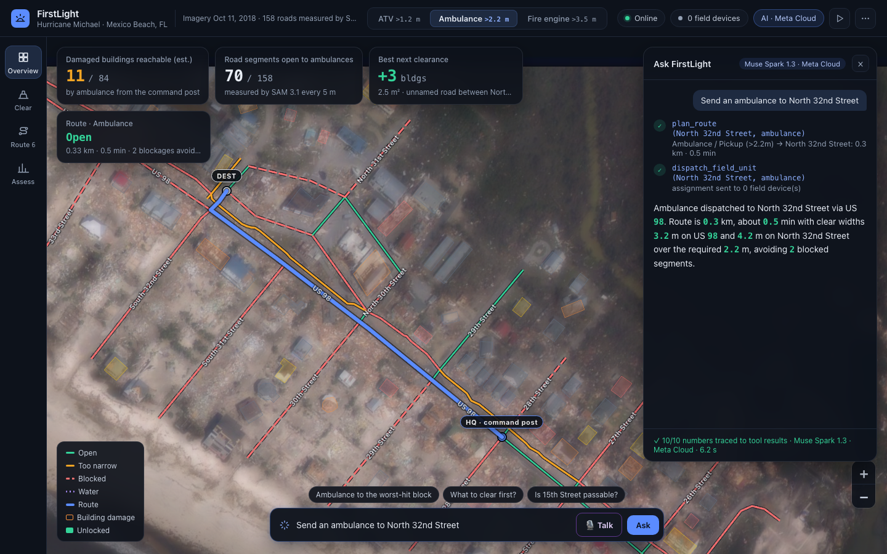
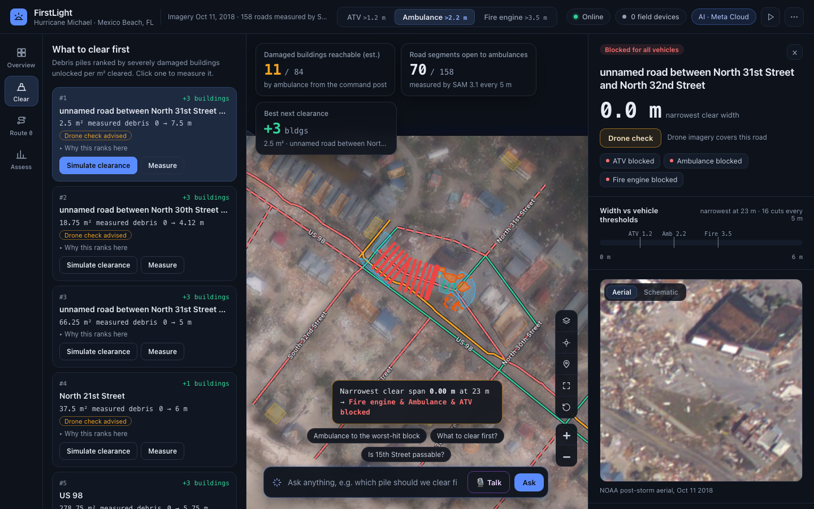
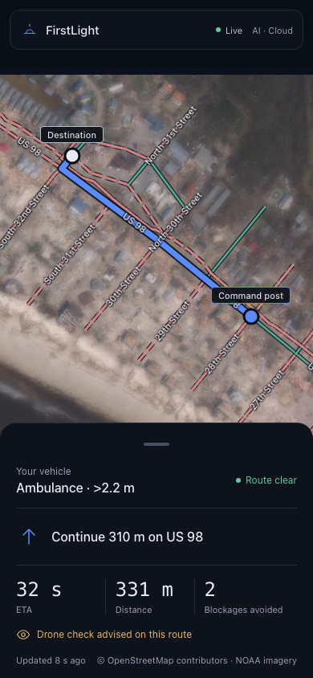
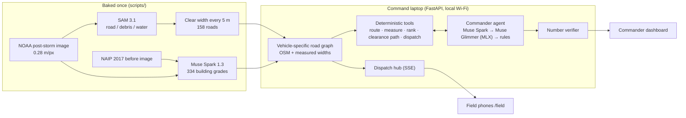

# FirstLight

**Offline-first disaster access mapping.** FirstLight tells emergency responders not just which buildings are damaged, but which vehicle (fire engine, ambulance or ATV) can physically reach them, and it keeps working when the internet goes down.

Built for the **Meta Global AI Developer Hackathon** on a real event: **Hurricane Michael at Mexico Beach, Florida** (landfall Oct 10, 2018).

| Submission | |
| :--- | :--- |
| Problem statement | Build for Your World |
| Prize track | Indie Developer |
| Team | Ambes Debretsion (solo) |
| Demo video | *link added at submission* |
| Built during the event | Everything except the pre-existing items in the [build log](#hackathon-build-log): the project plan, agent rules, public data and model downloads, and three early scaffolding commits whose code was deleted or rewritten during the event. |
| Runs without an API key or model download | Yes: see [Quickstart](#quickstart) |



---

## Why

Damage maps (xView2, Microsoft and others) show *what* is destroyed. After a hurricane, responders also need to know *what they can reach*: a street with 2.8 m of clear pavement lets an ambulance through but stops a fire engine. They need that answer when cell towers and backhaul are down.

## What it does

| | |
| :--- | :--- |
| **SAM 3.1 as a measuring instrument** | Segments visible pavement, debris and standing water on the post-storm aerial image, then measures the **clear road width in metres every 5 m** along all 158 roads. |
| **Vehicle-specific routing** | ATV needs > 1.2 m, ambulance > 2.2 m, fire engine > 3.5 m; standing water closes a road for everyone; ambulances and fire engines stay off footways. |
| **Building damage from before/after imagery** | Muse Spark grades all 334 buildings from a 2017 (before) / 2018 (after) image pair. |
| **What to clear first** | Ranks debris piles by severely damaged buildings unlocked per m² cleared. For a block no vehicle can reach, finds the set of segments with the least total debris whose clearance opens a route, and says which need drone recon first. |
| **Drone check for uncertain roads** | Roads flagged "drone check advised" can be re-measured with the same SAM 3.1 instrument on real drone imagery of Mexico Beach (CRASAR, about 1.8x sharper), and the routes update live. |
| **Commander agent with number-checked answers** | Ask in plain language. Muse Spark calls deterministic tools, and **every number in its answer must appear in a tool result** (a numeric consistency check). |
| **Three-tier failover** | Meta Cloud (Muse Spark) → Muse Glimmer 30B on the laptop (MLX, 4-bit) → no-model geometry and routing. The map never goes dark. |
| **Live field phones over local Wi-Fi** | Phones follow the commander's dispatch in real time and detect internet loss within about 5 s. |
| **Honest, held-out benchmark** | Model outputs are scored against blind hand labels; tuning and test sets are separate. |

<p align="center">
  
  
</p>

---

## Meta models and how they are used

| Model | Where it runs | Job in FirstLight |
| :--- | :--- | :--- |
| **SAM 3.1** (`Sam3Model`, fp16) | Locally on Apple Silicon (PyTorch MPS) | Text-prompted segmentation (`road`, `debris`, `standing water`) on 89 road tiles; the probability maps drive the 5 m width measurements. Baked once (~5 min on an M1 Max), so the field laptop needs no GPU work at demo time. |
| **Muse Spark 1.3** (`muse-spark-1.3`) | Meta Model API | (1) Grades each building from a before/after image pair (xBD scale). (2) Plans the commander agent's tool calls with native function calling and writes the answer. (3) Grades a selected road corridor from its aerial crop. |
| **Muse Glimmer 30B, 4-bit** (open weights) | Locally on Apple Silicon (MLX) | Offline fallback for grading and for the agent (same tools via a JSON action protocol). Kept resident in memory. Grades with low reasoning; agent steps skip reasoning, since every number is verified against tool output anyway. Chosen over Llama 3.2 11B Vision by comparing both on the test set ([comparison](#offline-model-choice)). |
| **Muse Voice Transcribe 1.0** (`muse-voice-transcribe-1.0`) | Meta Model API (realtime WebSocket) | Push-to-talk questions to the commander agent. The dashboard streams microphone audio through the laptop (the API key never reaches the browser), and the words appear as they are recognised. The final transcript arrives about 0.25 s after release. It needs the internet; when the link is down the dashboard says to type instead. |

Experimental integration (in the UI, not part of the core demo): **Muse Wonder 1.0** incident briefing. It labels its output with the model or fallback that produced it.

**Every model FirstLight calls at runtime is a Meta model.** Llama 3.2 11B Vision (also Meta) appears only in the offline-model comparison benchmark; the app never calls it.

---

## Bonus categories

**Best Build on Meta Open Weight Models: Muse Glimmer 30B on the laptop.** `mlx-community/Muse-Glimmer-30B-4bit` runs on the command laptop itself (Apple M1 Max, 64 GB) through MLX (`mlx-vlm`), with no cloud or partner inference. It is FirstLight's offline brain:
- **Two jobs:** it grades road corridors from their aerial crop (low reasoning), and it runs the commander agent with the same seven tools through a JSON action protocol, its numbers checked like Muse Spark's.
- **Always ready:** warm-up loads it at startup and pre-grades the top choke points; it stays resident, and a commander question preempts any background grading.
- **When it takes over:** automatically when the internet drops (a 5 s probe of the Meta API host), or with the Comms blackout switch.
- **Chosen by measurement:** it beat Llama 3.2 11B Vision on the [comparison](#offline-model-choice) (53 % vs 5 % exact grades, tool use on 3/3 vs 1/3 agent questions).
- **How to see it running:** the AI pill and the agent's answer card read "Muse Glimmer · on this laptop"; `GET /api/health` shows `vlm_tiers.tier_2_runtime.resident: true`. On the laptop an agent step takes about 20 s, so a question takes 45–85 s.

**Best Agentic Use-Case: a commander agent that plans, checks and dispatches.** Muse Spark 1.3 plans with native function calling over seven deterministic tools (`measure_road`, `damage_hotspots`, `plan_route`, `plan_clearance_path`, `rank_clearance`, `reachability_summary`, `dispatch_field_unit`), for up to six steps per question:
- **Multi-step:** "Can an ambulance reach the worst-hit block?" runs `damage_hotspots` → `plan_route` (blocked) → `plan_clearance_path`, and answers with the 3 segments (36 m²) to clear for a 1.3 km route.
- **Acts in the world:** "Send an ambulance to North 32nd Street" plans the route and calls `dispatch_field_unit`; field phones on the local Wi-Fi switch to the new route within a second. Dispatch refuses a destination with no passable route.
- **Checked:** every number in the answer must appear in a tool result; an answer that fails gets one rewrite, then any remaining number is shown in red.
- **Keeps working offline:** the same agent runs on Muse Glimmer when the internet is down, and on rules and templates when no model is available. Questions can be spoken (Muse Voice Transcribe) when online.

## How it works



**Road width measurement** ([`src/sam_measure.py`](src/sam_measure.py)). At every 5 m along each OSM centerline, a 30 m cross-section is sampled every 0.25 m from SAM's probability maps:
- Pavement is detected at p ≥ 0.5, and its width is measured over the confident core (p ≥ 0.7). This trims the blur that comes from upsampling SAM's 288-cell maps.
- The run of pavement **nearest the OSM line** is used, which absorbs the few-metre misalignment between OSM and the imagery.
- Widths are capped by OSM road type, so parking lots and intersections can't inflate a street.
- An obstruction must persist over two consecutive cross-sections before it closes a road.
- Gaps are attributed to **debris** (clearable), **standing water** (impassable), or **not visible**. Not-visible gaps are treated as impassable and flagged for drone reconnaissance.

**Routing and clearance** ([`src/routing.py`](src/routing.py)). Edge weights are length / speed (ATV 8.0, ambulance 13.5, fire engine 11.2 m/s) on passable edges and ∞ otherwise. The clearance queue simulates removing each debris pile and counts the severely damaged buildings that become reachable from the command post at US‑98 & 28th Street.

For ambulances and fire engines, no single pile opens any of the five worst-hit blocks (for an ATV, one pile opens the fourth), so the **clearance path** solves a least-cost path instead:
- **Cost model:** passable segments cost almost nothing, and a blocked segment costs its measured debris in m².
- **Excluded:** water, footways for vehicles, and roads too narrow even when clear.
- **Unmeasured segments:** where SAM saw neither pavement nor debris, the segment is charged a fixed penalty and reported as unmeasured, never given an invented area.
- **Check:** the plan is verified by clearing those segments and re-running the router.
- **Example:** an ambulance to the worst-hit block needs 3 segments cleared (36 m² measured, 1 unmeasured, all 3 flagged for drone recon) for a 1.3 km route.

**Commander agent** ([`src/agent.py`](src/agent.py), [`src/agent_tools.py`](src/agent_tools.py)). Seven tools: `measure_road`, `damage_hotspots`, `plan_route`, `plan_clearance_path`, `rank_clearance`, `reachability_summary`, `dispatch_field_unit`. They only read the measured graph and the graded buildings. After the model answers:
- every number in the answer must appear in a tool result. This is a numeric consistency check: it catches invented numbers, but not a real number attached to the wrong road;
- untraceable numbers get one rewrite, then are shown in red;
- dispatch refuses destinations with no passable route.

**Failover and field sync** ([`src/failover.py`](src/failover.py), [`src/dispatch.py`](src/dispatch.py)):
- A 5 s TCP probe detects internet loss, so Tier 1 is skipped immediately rather than timing out.
- Real Muse Spark answers are cached, and the top choke points are pre-warmed at startup.
- Phones receive route updates over Server-Sent Events.

---

## Results (held-out, labelled blind)

Labels were recorded in the built-in `/label` tool, which never shows model answers. Tuning used the **dev** set only. The **test** set was drawn afterwards with a different seed, disjoint from dev.

| Measure | Dev baseline | Dev after tuning | **Test (held-out)** |
| :--- | :---: | :---: | :---: |
| SAM 3.1 width, median absolute error | 1.94 m | 1.37 m | **0.39 m** |
| SAM 3.1 width, mean error / bias | 3.45 m / +2.22 m | 2.22 m / +0.53 m | **1.09 m / −0.04 m** |
| Passability agreement ATV / ambulance / fire engine | 78 / 83 / 80 % | 78 / 83 / 78 % | **97 / 94 / 97 %** |
| False-passable (dangerous) ATV / ambulance / fire | 5 / 3 / 5 | 5 / 3 / 5 | **0 / 0 / 0** |
| Muse Spark grade within one class | 88 % | 90 % | **89 %** |
| Muse Spark exact 4-class match | 58 % | 68 % | **47 %** |
| High-severity recall / precision | 1.00 / 0.38 | 1.00 / 0.56 | **0.40 / 0.22** |

- **Sample sizes:** roads, 40 dev and 35 test (5 marked "can't tell"); buildings, 40 dev and 38 test. Only 5 test buildings are major or destroyed, so the building scores carry wide uncertainty.
- **Confidence is calibrated:** on the test set, stations with SAM confidence ≥ 0.8 have a mean error of 0.35 m, versus 4.06 m at 0.6–0.8. That is why low-confidence stations are flagged for drone reconnaissance.
- **What was tuned on dev:**
  - the core-width rule and the road-type caps (the caps are typical US curb-to-curb widths, not fitted to the labels);
  - an xBD-strict grading prompt.
- **On today's data:** from the command post, an ambulance reaches 11 of the 84 buildings Muse Spark grades major or destroyed. The clearance queue shows which piles change that.

Reproduce: `./.venv/bin/python benchmarks/run_benchmarks.py` → [`benchmarks/benchmark_results.json`](benchmarks/benchmark_results.json).

### Offline model choice

Two open-weights models were scored on the same 38 held-out test buildings, using the same prompt and before/after images as Muse Spark, on the M1 Max. Because this comparison chose Muse Glimmer, its scores here are a model-selection result, not an untouched estimate of its accuracy.

| Model (MLX, 4-bit) | Exact | Within one class | High-severity recall / precision | Median s per building | Agent questions answered with a tool call |
| :--- | :---: | :---: | :---: | :---: | :---: |
| Llama 3.2 11B Vision | 5 % | 13 % | 1.00 / 0.13 | 14.8 | 1 / 3 |
| Muse Glimmer 30B, reasoning skipped | 18 % | 26 % | 1.00 / 0.15 | 15.7 | 3 / 3 |
| **Muse Glimmer 30B, low reasoning** | **53 %** | **76 %** | **1.00 / 0.28** | 38.8 | **3 / 3** |
| *Muse Spark 1.3 (cloud, for reference)* | *47 %* | *89 %* | *0.40 / 0.22* | — | — |

- **Llama calls almost everything severe.** It also answered "Is 15th Street passable?" without measuring the road.
- **Muse Glimmer at low reasoning grades.** It is now the offline tier.
- **Agent steps skip reasoning.** Tool choice is just as good without it, and every number in the answer is checked against tool output either way.

Reproduce: `./.venv/bin/python benchmarks/edge_model_comparison.py` → [`benchmarks/edge_model_comparison.json`](benchmarks/edge_model_comparison.json) (about 50 min).

### Independent check: CRASAR drone labels

[CRASAR-U-DROIDs](https://huggingface.co/datasets/CRASAR/CRASAR-U-DROIDs) (Center for Robot-Assisted Search and Rescue, CC BY 4.0) includes two drone surveys of Mexico Beach, flown Oct 13 and Oct 14, 2018 at about 2 cm per pixel. Its expert annotators labelled building damage (same xBD scale) and road conditions along OpenStreetMap roads. None of it was used to produce the grades and widths checked here: those come from the Oct 11 NOAA image at 0.28 m per pixel. (The drone *imagery* is used separately in the drone-check experiment below.)

| Check | Result |
| :--- | :--- |
| Roads CRASAR marks **totally blocked** (19 of the 100 roads both cover) | SAM 3.1 had closed **18** of them to ambulances (95 %) |
| Roads SAM 3.1 calls **open to fire engines** (41) | CRASAR marks **1** as totally blocked |
| Roads SAM 3.1 blocks but CRASAR saw clear (18) | **14** were already flagged for drone recon (mostly sand or no visible pavement) |
| Muse Spark building grades vs CRASAR drone labels (236 matched buildings) | within one class **80 %**, exact 34 %, high-severity precision 0.64 / recall 0.44 |
| Our own hand labels vs CRASAR drone labels (59 buildings) | within one class 90 %, exact 44 % |

- **Read the building rows together:** even careful human labels made from the NOAA image match drone-based labels exactly only 44 % of the time. Exact grades are limited by the image, not just the model, and CRASAR has reported that lower-resolution imagery under-reports damage.
- **Method:**
  - Buildings are matched by footprint overlap (IoU ≥ 0.3).
  - Roads count as covered when CRASAR's road lines run along at least 80 % of them.
  - Labels in the 8 m at each road end are ignored, because they belong to the crossing street; road stubs under 24 m are skipped.
  - "Total" obstruction, destruction or flooding counts as blocked.
- **Caveat:** the drone flights were two to three days after the NOAA photo, so some roads may already have been partly cleared.

Reproduce: `./.venv/bin/python benchmarks/crasar_validation.py` → [`benchmarks/crasar_validation.json`](benchmarks/crasar_validation.json).

### Drone check: re-measuring flagged roads

The NOAA image flags 80 roads "drone check advised" (no visible pavement, sand, or low confidence). In the field a crew would fly a drone over them. FirstLight shows what that step does with drone imagery that already exists: CRASAR's Oct 13 and Oct 14 orthomosaics. **This is a recorded-data experiment, not a live flight:** the measurements are computed in advance, and the dashboard's **Drone check** applies them.

- **How:**
  - only a patch around each road is read, over HTTP from the internal overviews, at about 0.16 m per pixel;
  - SAM 3.1 segments it with the same prompts, and the same 5 m cross-sections measure it;
  - roads are measured once offline (`scripts/drone_remeasure.py`) and stored in `data/sam31_drone_measurements.json`;
  - in the dashboard, **Drone check** in the road inspector applies a road's drone measurement. The routes, the KPIs and the field phones update, and **Undo drone checks** restores the NOAA measurements.
- **Coverage:** 74 of the 80 roads have full drone coverage; 6 are skipped because the flights cover only 0–96 % of them.
- **Rule:**
  - on the NOAA image, an obstruction must persist over two cross-sections to close a road (noise suppression at 0.28 m per pixel);
  - on drone imagery, one narrow cross-section is enough.
- **What changes:** 13 roads open to ambulances, 16 to fire engines and 15 to ATVs; 38 of the 74 still advise a closer look.

| Against CRASAR's road labels (100 roads) | NOAA only | After all drone checks |
| :--- | :--- | :--- |
| CRASAR **totally blocked** roads (19) kept closed to ambulances | 18 | **18** |
| Roads SAM 3.1 blocks but CRASAR saw clear | 18 | **11** |
| Roads open to fire engines (CRASAR totally blocked among them) | 41 (1) | **50 (1)** |

- **Disclosure:** the one-cross-section rule was chosen after comparing it with CRASAR's road labels. The two-cross-section rule removed more false blockages (18 → 7) but opened 2 roads CRASAR marks totally blocked. We kept the rule that loses no blocked road, so this table is not a blind test.
- **Same caveat as above:** the drone flights were two to three days after the NOAA photo, so roads may have been partly cleared in between.

Reproduce: `./.venv/bin/python scripts/drone_remeasure.py` (needs the internet; reads road patches from Hugging Face and caches them in `data/drone_cache/`), then `benchmarks/crasar_validation.py` (`roads_after_drone_checks`).

## Limitations

- **Answer checking is numeric:** the agent's numbers must come from tool results, but a correct number attached to the wrong road would pass. The deterministic answer templates avoid this; model-written answers rely on the tools' labelled fields.
- **Damage grades are model estimates:** "severely damaged buildings" counts are Muse Spark grades (high-severity precision 0.22 on test), useful to prioritise checks, not confirmed damage.
- **Sand-covered pavement:** SAM can confidently read it as clear road (3 false-passables on dev).
- **SAM misses some faint roads:** these are treated as blocked and flagged for drone reconnaissance (the conservative choice).
- **Building grading is the weakest part:**
  - the 2017 NAIP "before" image is 1 m resolution, and OSM footprints can be offset by several metres;
  - tuning gains on dev did not carry over to test.

  Treat grades as triage hints.
- **Meta's content filter** occasionally rejects harmless questions. The agent says so and answers on the laptop instead.
- **Cloud agent answers take about 7–12 s;** the steps appear live while it works.
- **Offline is slower:**
  - each agent step takes about 20 s on the laptop, and a question takes 45–85 s;
  - an offline road grade takes about 85 s. Warm-up pre-grades the top five choke points on the laptop, so those open instantly.

---

## Quickstart

Tested on an Apple Silicon Mac (M1 Max, 64 GB) with Python 3.11+.

**Judge quick path (no API key, no model download).** The SAM 3.1 measurements, Muse Spark grades and drone re-measurements are committed, so a fresh clone runs the dashboard, measurement views, routing, clearance planning, drone check, field phones and the rules-only agent:

```bash
python3 -m venv .venv && ./.venv/bin/pip install -r requirements.txt
./.venv/bin/python scripts/setup_data_and_models.py --download --no-models   # ~1 min: map tiles + drone photos (~124 MB)
./.venv/bin/uvicorn src.app:app --host 0.0.0.0 --port 8000
```

**Full Meta setup (the AI tiers):**

```bash
cp .env.example .env    # add your Meta Model API key: Muse Spark agent and grading, Muse Voice
./.venv/bin/python scripts/setup_data_and_models.py --download   # + Muse Glimmer 30B 4-bit (~17 GB) and SAM 3.1
./.venv/bin/python scripts/setup_data_and_models.py --check      # shows what each optional asset enables
```

Muse Glimmer runs through MLX, so the on-laptop AI tier needs Apple Silicon. SAM 3.1 weights are only needed to re-run the measurement bake.

| Page | URL |
| :--- | :--- |
| Commander dashboard | `http://localhost:8000/` |
| Field phone (same Wi-Fi) | `http://<laptop-ip>:8000/field` (hover the **FIELD LINK** pill for the address) |
| Blind labelling tool | `http://localhost:8000/label` |

Rebuild the derived data (all offline after the first download):

| Script | Produces |
| :--- | :--- |
| `scripts/fetch_pre_event_naip.py` | `data/naip_2017_mexico_beach.tif` (before image) |
| `scripts/bake_sam31_masks.py` | SAM 3.1 probabilities, masks and road measurements (`--remeasure` reuses the probabilities) |
| `scripts/grade_buildings_muse_spark.py` | Muse Spark building grades (cached and resumable; about $1 of API credit for all 334) |
| `scripts/drone_remeasure.py` | SAM 3.1 drone re-measurements of flagged roads (`--rederive` recomputes verdicts from stored cross-sections) |
| `scripts/build_map_tiles.py` | Full-resolution offline map tiles |
| `scripts/make_benchmark_samples.py` | Held-out label samples (`--set test` for the final set) |

Environment switches:

| Variable | Effect |
| :--- | :--- |
| `FIRSTLIGHT_WARMUP=0` | Skip the startup Muse Glimmer load and the Muse Spark / Muse Glimmer pre-grading of the top choke points. |
| `FIRSTLIGHT_SPARK_REASONING_EFFORT=` | Use Muse Spark's default reasoning effort (default here: `low`). |
| `FIRSTLIGHT_UPLINK_PROBE=0` | Disable internet-loss detection. |

Tests: `./.venv/bin/pytest`.

---

## Hackathon build log

Building opened when the kickoff ended, at 12:24 PM ET on Oct 26, 2026, and runs until Nov 4.

- **Pre-existing (before 12:24 PM ET):**
  - the project plan ([`PLAN.md`](PLAN.md)) and agent rules (`.agents/`, the first lines of `AGENTS.md`);
  - public data and model downloads: the NOAA post-storm image of Mexico Beach (`data/noaa_michael_mexico_beach.tif`), OpenStreetMap extracts (`data/osm_*`), and the SAM 3.1 and Llama 3.2 weights;
  - three early commits, listed here with what happened to each:

    | Commit (Oct 26) | Contents | Status |
    | :--- | :--- | :--- |
    | `04542ed` 12:01 PM | `PLAN.md`, agent rules (`.agents/`, `AGENTS.md`), `requirements.txt`, `.gitignore`, vendored Leaflet 1.9.4 | Plan kept unchanged as a record; requirements and `.gitignore` rewritten since; Leaflet is the unmodified third-party library |
    | `b489ebe` 12:15 PM | OpenStreetMap extracts (`data/osm_*`), `pyproject.toml`, `src/geometry.py`, `tests/test_geometry.py` | OSM data unchanged (public data); geometry code, tests and config rewritten in `a78547e` (Oct 30) |
    | `4a06adc` 12:24 PM | Grading router in `src/failover.py`, `tests/test_failover.py` | Rewritten in `a78547e` (Oct 30) |

    Lines that `git blame` still attributes to those commits are shared imports, constants and interface names. History is kept as it happened; nothing was re-dated.
- **Built during the event:** everything else.
  - **Oct 26:** first versions of routing, the API and the dashboard, then the field-phone sync, latency work and the measurement replay (`80b1501` … `bc39159`).
- **Building period (Oct 27 onward):**
  - real SAM 3.1 measurements replacing rule-placed obstacle polygons (`6410e01`);
  - blind labelling and the held-out benchmark (`2e1b948`, `a6e53af`);
  - per-building Muse Spark grading from before/after imagery (`302c3f9`, `bdb80f6`);
  - the commander agent with verified answers (`c7402dc`);
  - offline full-resolution tiles (`e29bd14`), and fixes (see `git log`);
  - Muse Glimmer 30B replacing Llama 3.2 Vision as the offline tier after a held-out comparison (Oct 28);
  - push-to-talk questions through Muse Voice Transcribe, replacing a preset-command placeholder (Oct 29);
  - least-debris clearance paths to blocks no vehicle can reach (Oct 29);
  - redesigned commander dashboard and field view: KPI cards, side panels, a Meta models panel and a road inspector (Oct 29);
  - independent check against CRASAR drone labels, and drone re-measurement of flagged roads (Oct 30);
  - street labels, measured cross-sections in the inspector, clearance ranking from the command post, internet-loss display on the dashboard, strict width thresholds, and a no-download judge setup (Oct 31–Nov 1);
  - calmer dashboard and field-phone styling: one KPI strip, "Command post" and "Destination" route labels, line icons, an amber AI pill when answers move on-device, and a route-wide "drone check advised" line on the phone (Nov 3).

---

## Repository layout

```text
src/
  app.py            FastAPI server: API, dashboards, labelling, tiles
  sam_measure.py    SAM 3.1 visible-pavement width measurement
  geometry.py       Reprojection, SAM 3.1 instrument wrapper, caliper GeoJSON
  routing.py        Vehicle-specific graph, routing, clearance ranking
  agent.py          Commander agent: tiers, tool loop, number verifier
  agent_tools.py    Deterministic tools the agent may call
  failover.py       3-tier grading (Muse Spark → MLX Muse Glimmer → geometry), resident MLX runtime
  mlx_patches.py    mlx-vlm cross-attention K/V memo (Llama 3.2 Vision, used in the model comparison)
  dispatch.py       Live dispatch hub (SSE) and internet-loss probe
  voice.py          Push-to-talk relay to Muse Voice Transcribe (realtime ASR)
  labeling.py       Blind labelling API
ui/                 Commander dashboard, field phone view, labelling page (Leaflet vendored)
scripts/            Data fetch, SAM bake, Muse Spark grading, tiles, benchmark samples
benchmarks/         run_benchmarks.py and results
data/               NOAA image crop, OSM extracts, SAM measurements, building grades, labels (other rasters and tiles rebuilt by scripts)
tests/              pytest suite
docs/img/           Screenshots
```

---

## Licenses and attribution

- **Code:** MIT ([`LICENSE`](LICENSE)).
- **Muse Glimmer 30B:** the offline tier uses `mlx-community/Muse-Glimmer-30B-4bit` (Apache 2.0).
- **Built with Llama.** The offline-model comparison also runs `mlx-community/Llama-3.2-11B-Vision-Instruct-4bit`, licensed under the Llama 3.2 Community License, Copyright © Meta Platforms, Inc. All Rights Reserved.
- **SAM 3.1:** Meta Platforms, Inc., under the SAM License (weights in `models/sam3.1`, transformers `Sam3Model` format).
- **Meta Model API** (`muse-spark-1.3`, `muse-voice-transcribe-1.0`, `muse-wonder-1.0`): used under the Meta Global AI Developer Hackathon terms.
- **Map data © OpenStreetMap contributors,** available under the Open Database License (ODbL).
- **NOAA National Geodetic Survey:** Hurricane Michael emergency response imagery (Oct 11, 2018). U.S. Government work, public domain.
- **CRASAR-U-DROIDs** (Center for Robot-Assisted Search and Rescue), CC BY 4.0:
  - Mexico Beach drone damage labels in `data/external/crasar/`, used only for evaluation;
  - patches of the Oct 13 and Oct 14, 2018 drone orthomosaics, re-measured with SAM 3.1 (`data/sam31_drone_measurements.json`).
- **USDA NAIP 2017 imagery,** via Microsoft Planetary Computer. Public domain.
- **Leaflet 1.9.4** (BSD-2-Clause), vendored in `ui/vendor/`.
